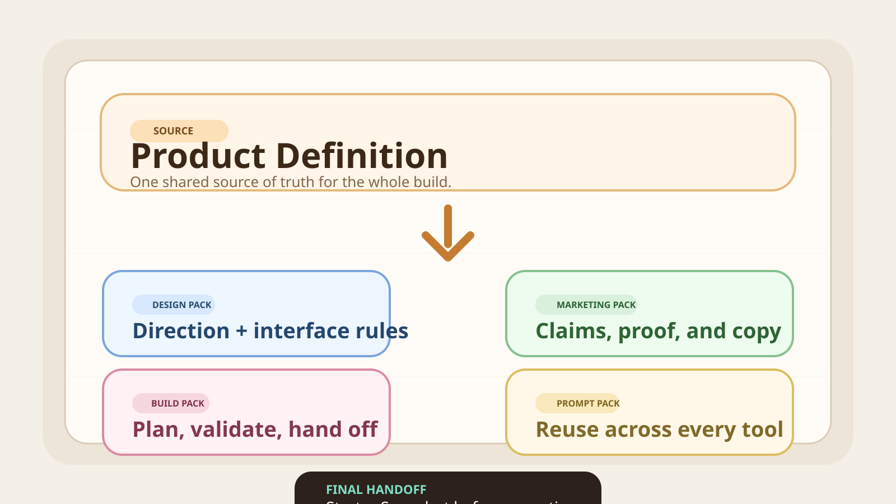

# Ship by Sunday

> Turn a rough product idea—or a codebase that has lost the plot—into an AI-ready system you can actually keep shipping.

[Explore the live product](https://www.man-meets-ai.com) · [Read the architecture](./docs/ARCHITECTURE.md) · [See the design system](./DESIGN.md)



Ship by Sunday is a production-shaped SaaS and agentic development platform. It captures durable product context, compiles that context into an executable codebase, and gives AI workers enough structure to make bounded changes with proof.

It supports two starting points:

- **Starter** turns a new idea into product truth, an AI-ready starter codebase, a Program, and executable plans.
- **Workers** diagnoses an existing web app locally, ranks its highest-leverage blockers, and runs approved worker loops without uploading the raw repository.

This is not a prompt collection or a toy generator. It is an attempt to make AI-assisted product development feel less like restarting in a chat window and more like improving a product with a spine.

## What makes it interesting

| Surface | What it does |
| --- | --- |
| Product workspace | Guides founders from rough intent to a reviewable product definition and downloadable codebase. |
| Codebase compiler | Converts structured product facts into design context, marketing direction, implementation plans, and agent instructions. |
| Local runner | Inspects existing repositories on the user's machine and shares only approved, sync-safe findings. |
| Worker loop | Turns larger initiatives into Programs and bounded ExecPlans, then returns proof or an honest blocked-proof report. |
| Production SaaS | Connects Clerk authentication, Stripe billing, Convex data, Vercel hosting, and PostHog observability. |

The core loop is deliberately simple:

```text
idea or existing repo
        ↓
product truth or local doctor pass
        ↓
Program → ExecPlans → approved worker loop
        ↓
diff + validation + proof + next recommendation
```

## Built with

- **Next.js 16**, **React 19**, and **TypeScript**
- **Convex** for the hosted backend and durable workflow state
- **Clerk** for authentication and protected product access
- **Stripe** for checkout, subscriptions, and entitlement handoff
- **Tailwind CSS** and **shadcn/ui** for the interface system
- **Effect** for typed orchestration in the local runner
- **Vitest** and **Playwright** for unit, integration, and browser coverage
- **Bun** workspaces for the monorepo toolchain

## Repository map

```text
apps/web/                         Next.js product, API routes, and Convex backend
packages/codebase-compiler/       Product-facts → agent-ready codebase compiler
packages/codebase-presentation/   Review and presentation layer for generated output
packages/local-runner/            Local-first diagnosis and worker orchestration
packages/telegram-chat-widget/    Product support and async interaction surface
templates/starter-app/            Generated starter application source
docs/                             Architecture, product, reliability, and operating docs
```

The protected Starter journey is:

```text
/starter/home → /starter/generate-codebase → /starter/generate-codebase/review
```

The Workers journey lives under `/workers`, beginning with local setup and the private doctor pass.

## Run it locally

### 1. Install dependencies

```bash
bun install
```

### 2. Create the local environment file

```bash
cp apps/web/.env.local.example apps/web/.env.local
```

Add development credentials for the providers you want to exercise. Set `APP_BASE_URL=http://localhost:3000` for local Stripe redirects.

### 3. Connect a hosted Convex development deployment

```bash
bun run dev:convex
```

### 4. Start the app

For the web app and hosted Convex workflow:

```bash
bun run dev:core
```

For the complete buyer flow, including local Stripe forwarding:

```bash
bun run dev
```

The repository intentionally uses hosted Convex development rather than Convex local mode.

## Quality gates

```bash
bun run format:check
bun run lint
bun run typecheck
bun run test:unit
bun run test:packages
bun run test:integration
bun run build
```

`bun run typecheck` exercises the production Next.js build as well as every TypeScript workspace. For the broad local verification path, run `bun run check`.

## Design and engineering notes

- [Architecture](./docs/ARCHITECTURE.md)
- [Product sense](./docs/PRODUCT_SENSE.md)
- [Frontend conventions](./docs/FRONTEND.md)
- [Reliability](./docs/RELIABILITY.md)
- [Security](./docs/SECURITY.md)
- [Design system](./DESIGN.md)
- [Contributor guide](./CONTRIBUTING.md)
- [Changelog](./CHANGELOG.md)

Ship by Sunday is built around one principle: **the first AI pass is never the finish line**. Product truth, execution plans, trust boundaries, and proof stay attached to the repository so the next change can begin with context instead of archaeology.
