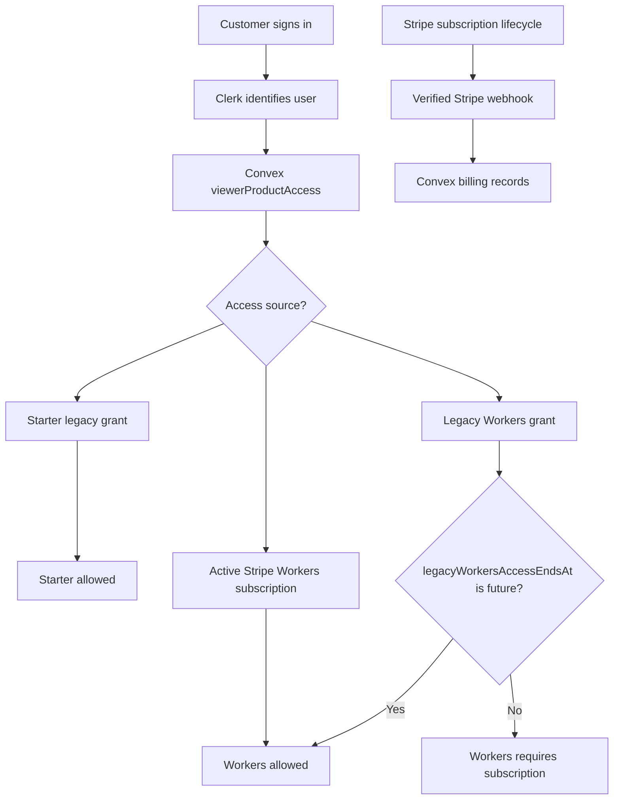
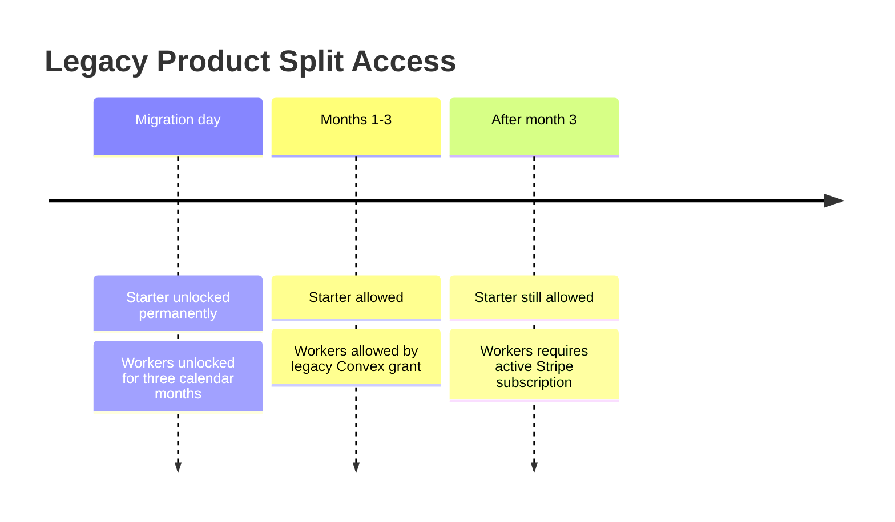

# Existing Customer Product Split Migration

This runbook is for manually migrating the small set of legacy paid customers after the product split into Starter and Workers.

Do not add real customer names, emails, Stripe IDs, Clerk IDs, Convex document IDs, or support-thread excerpts to this file. Record customer-specific decisions in the operator-owned customer tracker, support thread, or provider dashboard notes.

## Current Product Paths

Starter is for customers starting from an idea, a Lovable-style prototype, or a prompt pile. It includes the guided codebase generator and lessons. The app destination is `/starter/home`.

Workers is for customers with an existing repo. It includes local runner setup, private doctor pass, top findings, one approved worker loop, and proof or blocked-proof report. The app destination is `/workers/setup`.

Some legacy customers may reasonably receive both if their original purchase covered the starter/generator material and they are also a fit for the founding Worker install.

## Migration Principles

Handle one customer at a time. Do not mass-update all legacy paid users.

Start from what the customer thought they bought, what they are currently trying to do, and what would be fair based on the new split.

Prefer clarity over strict automation. If the fit is ambiguous, ask the customer which path they want before changing access.

Do not revoke working access as part of cleanup unless the customer explicitly asks for a different path and the replacement access has been verified.

## Legacy Split Contract

Legacy customers who bought the pre-split blended offer receive:

- Starter access permanently.
- Workers access for three calendar months from the migration date.
- No Worker Seal Team 6 access unless that service was separately promised.
- No new Stripe charge and no synthetic Stripe subscription.

Stripe remains the source of truth for real paid Workers subscriptions. Convex owns explicit manual exceptions for legacy customers through `productAccessGrants.legacyWorkersAccessEndsAt`. When that timestamp is in the future, the `worker` capability is active even if the customer has no active Workers subscription. After that timestamp, Starter capabilities remain active and Workers requires a real active Stripe subscription.





## Decision Paths

Choose Starter when the customer primarily wants to start from an idea, generate a customized repo, use the template, or watch the guided lessons.

Choose Workers when the customer already has a repo and wants diagnosis, worker setup, a doctor pass, findings, an approved loop, and proof.

Choose both when the customer bought the older blended product, still needs the generator or lessons, and is also a clear existing-repo Worker fit.

Choose bespoke/manual follow-up when the purchase context is unclear, the customer expected something outside current Starter or Workers scope, or the operator wants to preserve goodwill before changing access.

## Grant Targets

Starter access should allow:

- `/starter/home`
- `/starter/generate-codebase`
- `/starter/generate-codebase/review`
- `/starter/lessons`
- `/starter/lessons/[lessonKey]`

Workers access should allow:

- `/workers/setup`
- `/workers/doctor-pass`
- `/workers/findings`
- `/workers/loops`
- `/workers/runs`
- `/workers/privacy`

Multi-product or unresolved access may still use `/home` as the recovery hub.

## Manual Procedure

1. Open the operator-owned customer record outside git.
2. Confirm the original purchase context and current customer goal.
3. Pick one migration outcome: Starter, Workers, both, or bespoke/manual follow-up.
4. For the legacy blended-offer migration, apply `entitlements:grantLegacyProductSplitAccess` with the resolved Clerk user id and a `legacyWorkersAccessEndsAt` timestamp three calendar months after the migration date.
5. Sign in as or verify with the customer account using approved operator tooling.
6. Confirm `/home` routes the customer to the right destination or shows the correct multi-product recovery state.
7. Confirm `/starter/home` and `/workers/setup` both load during the three-month Workers window.
8. Record the outcome, date, operator, Workers end date, and verification evidence outside git.

Use hosted Convex dev first:

```bash
WORKERS_END_MS="$(node -e 'const d = new Date(); d.setUTCMonth(d.getUTCMonth() + 3); console.log(d.getTime());')"
node ../../node_modules/convex/bin/main.js run entitlements:grantLegacyProductSplitAccess \
  "{\"clerkUserId\":\"user_...\",\"legacyWorkersAccessEndsAt\":${WORKERS_END_MS}}"
```

After the same code is deployed to production Convex, use production:

```bash
WORKERS_END_MS="$(node -e 'const d = new Date(); d.setUTCMonth(d.getUTCMonth() + 3); console.log(d.getTime());')"
node ../../node_modules/convex/bin/main.js run --prod entitlements:grantLegacyProductSplitAccess \
  "{\"clerkUserId\":\"user_...\",\"legacyWorkersAccessEndsAt\":${WORKERS_END_MS}}"
```

Verify the row through the debug boundary:

```bash
node ../../node_modules/convex/bin/main.js run --prod entitlements:getProductAccessDebug \
  '{"clerkUserId":"user_..."}'
```

## Verification Checklist

For Starter, verify the customer can open `/starter/home`, see both Starter paths, open `/starter/generate-codebase`, and open `/starter/lessons`.

For Workers, verify the customer can open `/workers/setup` and cannot accidentally receive Starter access unless the migration decision was both.

For both, verify `/home` shows the expected product chooser or recovery state and that both product route families load.

For the legacy split migration, verify that `viewerProductAccess` includes `generate_codebase`, `tutorials`, and `worker` before `legacyWorkersAccessEndsAt`, and includes only Starter capabilities after that timestamp unless the customer has an active Stripe Workers subscription.

For bespoke/manual follow-up, leave the existing access unchanged until the customer-specific decision is recorded.

## Test Brief

Feature: migrate pre-split paid customers into lifetime Starter access plus a three-month Workers exception without charging them again.

Risk: P0 because the change affects billing-linked authorization and production customer access.

Source of truth: Convex `productAccessGrants` for the manual legacy exception, Stripe billing records for real Workers subscriptions, and Clerk user ids for identity.

Must work: an unexpired legacy split grant allows Starter and Workers routes; an expired legacy split grant keeps Starter routes open and locks Workers unless a real active Workers subscription exists.

Must fail safely: missing Clerk user id, wrong Clerk user id, expired Workers exception, canceled Workers subscription, and no grant must not unlock Workers.

Tests: entitlement unit coverage for active and expired legacy Workers access; hosted Convex dev migration run before production; production debug verification after mutation.

CI gate: baseline static/integration plus Convex production deploy and production release proof when this code ships.

## Do Not Commit

- customer names
- customer email addresses
- Stripe customer IDs
- Stripe checkout session IDs
- Clerk user IDs
- Convex document IDs
- payment screenshots
- support thread excerpts
- private migration outcomes

Keep this file as the reusable procedure. Keep real migration evidence in the operator-owned system.
